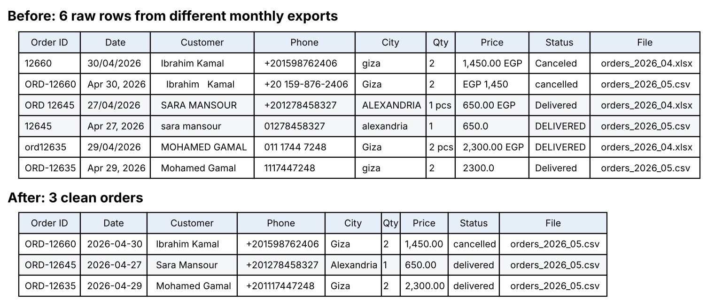

# Sales Data Cleanup & Automation

> **Portfolio project with generated sample data.** The store, customers and orders are fictional. The problems are the kind small businesses deal with every month.

Six months of order exports from three different tools, merged into **one clean, deduplicated dataset** with a customer table and a data quality report, by running **one command**.



## Problem

"Nile Basket", an online home-goods store in Egypt, exports its orders every month, but from a different tool each time: the web shop (Jan, Feb), a sales rep's Excel sheet (Mar, Apr) and a new POS system (May, Jun). The owner wants to answer simple questions (revenue per month, best customers, cancellation rate) and can't, because:

- Column names change between files (`Order ID`, `order_no`, `OrderID`)
- Dates come in 3 formats (`2026-03-09`, `09/03/2026`, `Mar 09, 2026`)
- Phone numbers come in 6 formats, and Excel drops the leading 0
- Customer names are typed in different cases, with extra spaces and different spellings (`Mohamed`, `Mohammed`, `Muhammad`)
- The last days of each month are exported again in the next month's file, sometimes with an updated status
- Prices arrive as `2,300.00 EGP` or `EGP 2,400`, quantities as `2 pcs`, and some rows are empty or broken

## Result

| Metric | Value |
| --- | ---: |
| Raw rows in 6 files | 4,698 |
| Clean, unique orders | **3,855** |
| Duplicate rows removed | 664 (130 inside a file, 534 re-exported in a later file) |
| Rows rejected and logged with a reason | 136 (36 of those orders kept from a valid copy elsewhere) |
| Phone numbers standardized to `+20…` | 3,771 |
| Customers whose name was spelled more than one way, merged by phone | 66 of 350 |
| Orders whose status was updated in a later export (latest kept) | 28 |
| Time to rerun on new exports | one command, about 1 second |

The full breakdown is in [`reports/data_quality_report.md`](reports/data_quality_report.md).

## Outputs

| File | What it is |
| --- | --- |
| `data/clean/orders_clean.csv` | One row per order, standard columns, ISO dates, numeric prices, `line_total` |
| `data/clean/customers.csv` | One row per customer (matched by phone): orders, delivered revenue, first and last order |
| `data/clean/rejected_rows.csv` | Every row that was not used, with its file, row number and the reason, so nothing disappears silently |
| `reports/data_quality_report.md` | Human-readable report of what was fixed and what still needs a person |
| `reports/summary.json` | The same numbers for other tools |

## Approach

1. **Load everything as text**, so phone numbers keep their leading zero and nothing is converted by accident.
2. **Map every known column name** to one schema. An unknown column stops the run with a clear error instead of being dropped.
3. **Clean each field with a small, tested function** (`cleaning/normalize.py`): order IDs, dates, names, Egyptian mobile numbers to E.164, emails, cities, payment methods, statuses, quantities and prices. A value that can't be trusted becomes empty instead of being guessed.
4. **Reject rows missing a required field** (order ID, date, product, quantity, price, status) into `rejected_rows.csv` with the reason.
5. **Deduplicate**: remove repeats inside a file, then keep one row per order, taking the copy from the **most recent export** because it carries the latest status.
6. **Build the customer table** by phone number, because names are spelled too many ways to be a reliable key.
7. **Write the data quality report** from the counts collected at every step.

## How to run

```bash
pip install -r requirements.txt
python scripts/generate_messy_data.py --out data/raw   # optional: recreate the messy sample files
python clean.py --input data/raw --output data/clean --report reports
```

To see each step with its output, open `notebooks/walkthrough.ipynb`. Run the tests with `python -m pytest`. Regenerate the image with `python scripts/make_before_after.py`.

## Using it on new data

- A new export with a new column name: add it to `COLUMN_MAP` in `cleaning/normalize.py`.
- A new city spelling: add it to `CITY_MAP`. Unmapped spellings are listed in the report.
- Monthly use: drop next month's export into `data/raw` and run the same command.

## Questions I would ask a real client first

- Which tool is the source of truth when two exports disagree?
- Should a zero or negative quantity be treated as a return instead of an error?
- Are there customers who share a phone number (family accounts, offices)?
- Which output format does the next step need: Excel, Google Sheets, or a database table?

## Tech

Python 3.10+, pandas, openpyxl, pytest, matplotlib (for the image only).

## Project structure

```
clean.py                      command-line entry point
cleaning/normalize.py         one function per field, all unit tested
cleaning/pipeline.py          load, standardize, validate, deduplicate, build outputs
cleaning/report.py            data quality report (Markdown + JSON)
scripts/generate_messy_data.py   creates the messy sample exports
scripts/make_before_after.py     draws docs/before_after.png
tests/test_normalize.py       35 tests for the field cleaners
notebooks/walkthrough.ipynb   runs the pipeline step by step and shows each result
```
